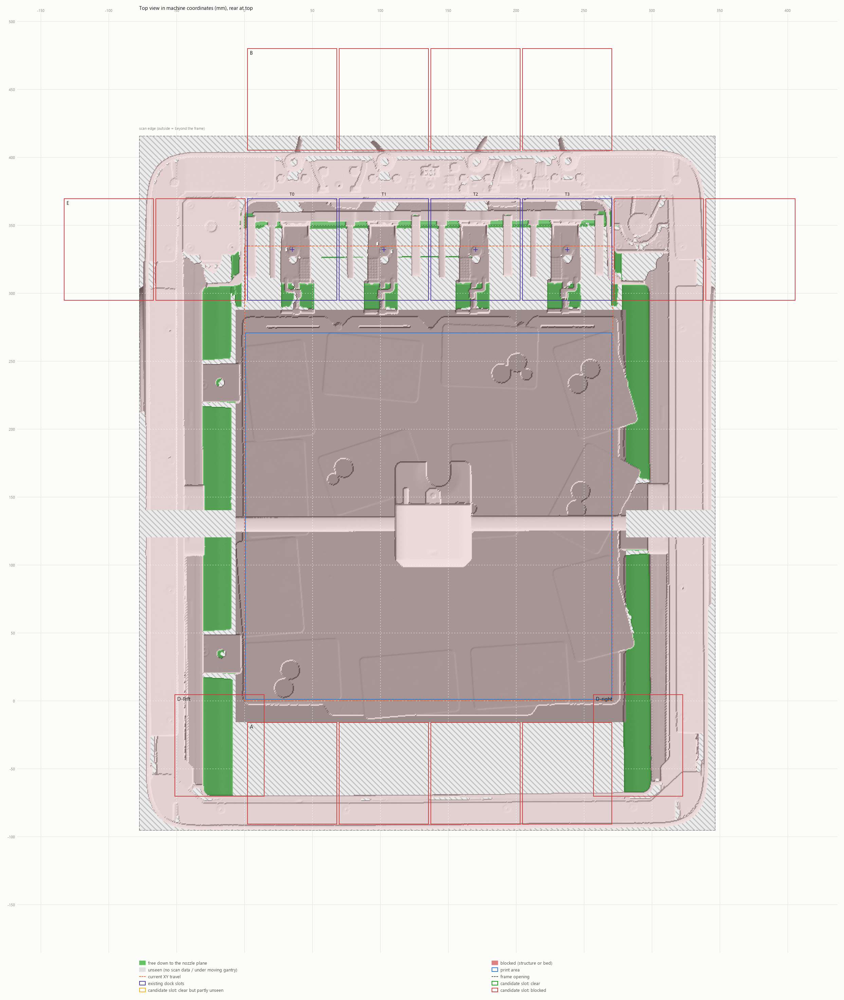
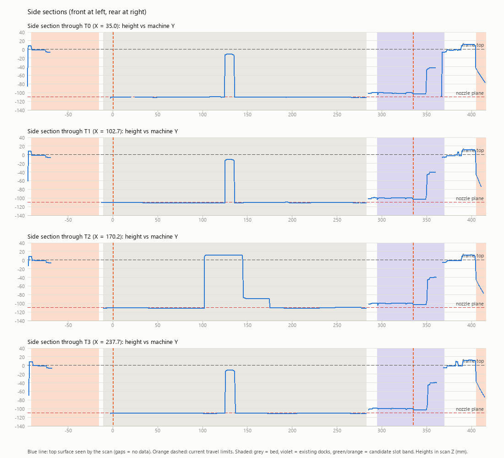
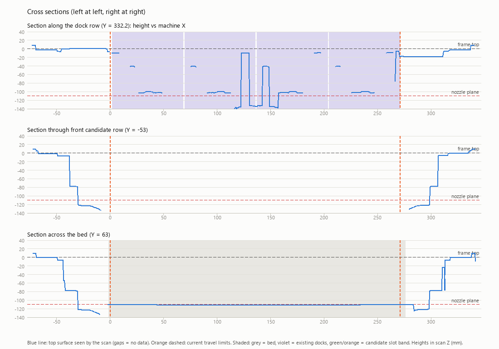

# U1 scan analysis: room for a second row of docks

Generated by `tools/scan_analysis/analyze_scan.py` from `u1-printer-no-top-med-align.stl` (4,219,223 triangles, 211 MB, analysed at 0.5 mm/cell in 7 s).

All XY values are **Klipper machine coordinates** (mm) after registration. Heights are scan Z (mm). The scan is a partial scan of the top section (toolhead level), Z -167..15; it only sees surfaces from above, so space under overhangs or below the scanned depth is *unseen*. Percentages are given as **strict / optimistic**: strict counts unseen cells as blocked, optimistic counts them as free.

## Verdict by option

A dock slot is modelled as **66.0 × 75 mm** (head 57.5 mm + 8.5 mm grab slide, × dock depth), free from the frame top down to 5 mm below the nozzle plane.

| Option | Where | Needed | Available (optimistic) | Shortfall | Travel change | Result |
|---|---|---|---|---|---|---|
| **A** Front row (mirrored docks) | in front of the bed (bed front edge Y -11) | 75 mm depth | 52 mm | 23 mm | Y min 0 → -53 | 0 of 4 slots clear |
| **B** Rear row behind existing docks | behind the dock row (Y 370 to scan edge 416) | 75 mm depth | 10 mm | 64 mm | Y max 335 → 443 | 0 of 4 slots clear |
| **D-left** Left side pocket | beside the bed, X -78..-6; widest free 75 mm long stretch | 66.0 mm width | 24 mm | 42 mm | X min → -18 | no slot fits |
| **D-right** Right side pocket | beside the bed, X 281..346; widest free 75 mm long stretch | 66.0 mm width | 18 mm | 48 mm | X max → 290 | no slot fits |
| **E** Extend the rear row sideways (longer X) | widest free gap in the dock row: 1 mm left of T0, 0 mm right of T3 | 66.0 mm gap per slot | 1 mm | 65 mm | X -32 .. 305 for one extra slot each side | 0 of 4 extra slots clear |

**C. Carousel / elevator** (swap heads into the existing 4 slots) is judged on the vertical budget:

- Frame top Z 0.3, nozzle plane Z -110.1: **110 mm** from frame top to nozzle plane.
- Active head/carriage top at Z 15.4, i.e. **126 mm** above the nozzle plane and +15 mm relative to the frame top.
- A second set of heads stacked above the dock row needs roughly 126 mm + clearance of extra height above the frame top (inside a taller lid), or the same below the dock row (below-row space is not visible in a top scan).
- Highest point of the existing dock structure: Z -5.3.

> **B:** Row-1 heads sit in the path to row 2 at the same X pitch, so a rear row only works if row 1 is staggered, moved or retracts. Space behind the scan edge is outside the frame.

## Candidate slots

Free fraction of each slot rectangle (strict / optimistic). Slots are centred on the nozzle pose.

| Option | Slot centre X, Y | Free | Result |
|---|---|---|---|
| A | 35.0, -53.2 | 0% / 72% | blocked 28% |
| A | 102.7, -53.2 | 0% / 72% | blocked 28% |
| A | 170.2, -53.2 | 0% / 72% | blocked 28% |
| A | 237.7, -53.2 | 0% / 70% | blocked 30% |
| B | 35.0, 442.8 | 0% / 13% | blocked 87% |
| B | 102.7, 442.8 | 0% / 13% | blocked 87% |
| B | 170.2, 442.8 | 0% / 13% | blocked 87% |
| B | 237.7, 442.8 | 0% / 13% | blocked 87% |
| D-left | -18.5, -32.8 | 33% / 59% | blocked 41% |
| D-right | 289.8, -32.8 | 28% / 53% | blocked 47% |
| E | -100.0, 332.2 | 0% / 7% | blocked 93% |
| E | -32.5, 332.2 | 8% / 17% | blocked 83% |
| E | 305.2, 332.2 | 7% / 21% | blocked 79% |
| E | 372.7, 332.2 | 0% / 7% | blocked 93% |

Sanity check, existing dock slots (should read as blocked, since the docks themselves are there):

| Tool | X, Y | Free | Result |
|---|---|---|---|
| T0 | 35.0, 332.2 | 8% / 50% | blocked 50% |
| T1 | 102.7, 332.2 | 9% / 49% | blocked 51% |
| T2 | 170.2, 332.2 | 8% / 49% | blocked 51% |
| T3 | 237.7, 332.2 | 8% / 49% | blocked 51% |

Longest free stretch found for each slot band (at least 90% of the band's width free along it):

| Option | Band X | Depth strict | Depth optimistic | Needed |
|---|---|---|---|---|
| A | 2..68 | 0 | 54 | 75 |
| A | 70..136 | 0 | 54 | 75 |
| A | 137..203 | 0 | 52 | 75 |
| A | 205..271 | 0 | 52 | 75 |
| B | 2..68 | 0 | 12 | 75 |
| B | 70..136 | 0 | 12 | 75 |
| B | 137..203 | 0 | 12 | 75 |
| B | 205..271 | 0 | 10 | 75 |
| D-left | width | 22 | 24 | 66.0 |
| D-right | width | 18 | 18 | 66.0 |

## Detected geometry

| Feature | Value |
|---|---|
| Scan extent | X -78..346, Y -95..416 (424 × 511 mm) |
| Frame opening | X -78..346, Y -95..416 (424 × 511 mm) |
| Bed plate | X -2..276, Y -11..283 (278 × 294 mm), Z -110.1 |
| Frame top Z | 0.3 |
| Gantry beam | Y 125..135 |
| Active head | X 111..167, Y 135..176, top Z 15.4 |
| Margin travel → opening | left 78, right 76, front 95, rear 81 (nozzle travel vs. frame opening; the head body extends beyond the nozzle) |
| Rear service zone | bed rear edge Y 283 → opening rear Y 416: 133 mm (holds the existing docks, purge and wipe) |
| Front gap | opening front Y -95 → bed front edge Y -11: 84 mm |

Registration (scan → machine):

- X coarse from bed centre: offset -338.8 mm
- X refined from dock pattern: offset -340.5 mm (peak 10 mm above median; bed centre disagrees by -1.8 mm)
- Y from bed centre = machine Y 136.0: offset 95.8 mm (assumption; set offset_y in the config if you know better)

Check `top_view.png`: the violet dock crosses should sit on the docked heads. If they don't, set `offset_x`/`offset_y` in a config file and re-run.

## Images

- `top_view.png` — free/blocked/unseen map with travel, print area, existing docks and candidate slots.
- `sections_y.png` — side sections through each dock X.
- `sections_x.png` — cross sections along the dock row, the front candidate row and the bed.

## Assumptions and limits

- Nozzle plane = detected bed surface (Z -110.1). If the bed was lowered when scanning, the real nozzle plane is higher and the result is conservative. Set `nozzle_z` to override.
- Slot size 66.0 × 75 mm is an estimate (`head_width_mm`, `dock_depth_mm`). Measure a real dock and re-run; the free-depth table shows how much margin each option has.
- The bed footprint is always blocked, because the bed rises to the nozzle plane.
- Cells under the gantry beam and active head are unseen because they move. Areas outside the scan count as blocked (beyond the frame).
- Cable/PTFE umbilicals, the enclosure panels, the lid and the door are not modelled.
- Effective settings are in `config_used.json`. Copy it, edit it, and pass it with `--config`.
